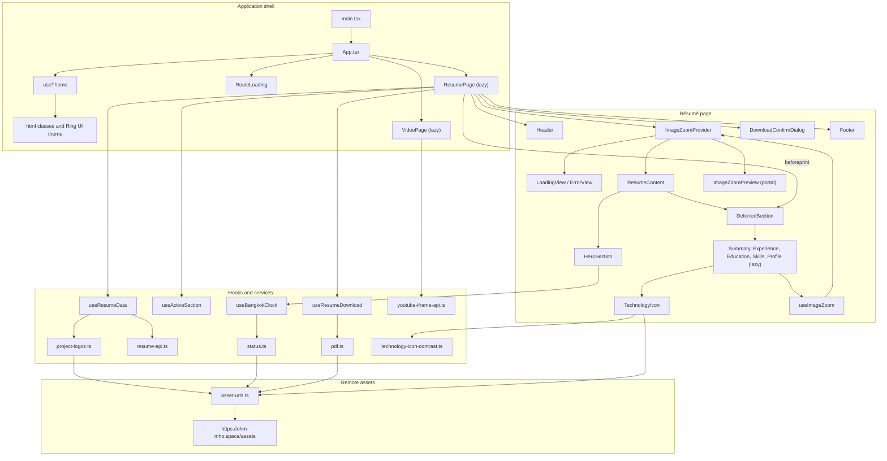

[](https://github.com/prettier/prettier)

# Nawaphon Isarathanachaikul — Résumé Portfolio (React Version)

A public React single-page résumé built with Ring UI and Tailwind CSS. It is kept in step with the Angular reference résumé at [nawaphonOHM/resume](https://github.com/nawaphonOHM/resume) (live at https://ohm-mho.space): the same content, layout, colours, print output and behaviour, drawn with Ring UI controls instead of Angular Material.

Features:

- Sticky toolbar with section links, a scroll-spy, icon controls with tooltips, and a popover menu on small screens.
- Light and dark themes that follow the system until the reader chooses one, and a light theme on paper.
- A hero with a live UTC+7 clock, an availability dot, and a favicon that follows the availability status.
- Sections that mount when they scroll into view, each with its own loading and error placeholder.
- Image previews for logos and technology icons that are drawn smaller than their natural size.
- A hosted PDF download with an availability check, a confirmation step, and progress feedback.
- A fallback page with a YouTube player for unmatched routes.

## Requirements

- Node.js 22 or newer
- npm 10 or newer

## Install and run locally

```bash
npm ci
npm run dev
```

Open `http://localhost:5173/`. The development server reloads when source files change.

Use the `localhost` host name rather than `127.0.0.1` when checking the fallback video page. In testing, YouTube played the video on a page served from `http://localhost` and reported it as unavailable on the same page served from `http://127.0.0.1`.

## Résumé data API

The résumé is loaded from eight API resources: `/api/v1/names`, `/api/v1/titles`, `/api/v1/summaries`, `/api/v1/details`, `/api/v1/links`, `/api/v1/skills`, `/api/v1/experiences`, and `/api/v1/educations`. Requests are made concurrently with the `X-Api-Type: resume-data` header, validated, and retried for transient failures.

All content comes from the API. The bundle contains no embedded profile, so the page shows a progress bar while the data loads and a retryable error panel when the API cannot provide a complete profile.

By default, the API must be available on the same origin as the app. Configure the web server or reverse proxy to forward those existing `/api/v1/...` routes to the résumé API; this repository does not include or create a backend, and `vite.config.ts` defines no development proxy.

To use an API hosted under a different origin or path prefix, set `VITE_RESUME_API_BASE_URL` before starting Vite or building the app. The configured value is prepended to the existing `/api/v1/...` routes, for example:

```bash
VITE_RESUME_API_BASE_URL=https://api.example.com npm run dev
VITE_RESUME_API_BASE_URL=https://api.example.com npm run build
```

For a cross-origin API, configure its CORS policy to allow the app origin and the `X-Api-Type` request header. Vite variables are embedded at build time, so production deployments must set the value when running `npm run build`.

## Static assets

Logos, technology icons, favicons and the hosted PDF are served from one flat directory:

```text
https://ohm-mho.space/assets/<file>
```

`src/data/asset-urls.ts` is the only module that knows this origin.

| Asset             | URL                                                                                          |
| ----------------- | -------------------------------------------------------------------------------------------- |
| Technology icon   | `https://ohm-mho.space/assets/spring.svg`                                                    |
| Company logo      | `https://ohm-mho.space/assets/wisesoft.png`                                                  |
| Status favicon    | `https://ohm-mho.space/assets/favicon.svg?` followed by URL-encoded `{"status":"available"}` |
| Hosted résumé PDF | `https://ohm-mho.space/assets/Nawaphon_Isarathanachaikul.pdf`                                |

The favicon status is `available`, `limited` or `unavailable`.

The API returns logo paths such as `/company-logos/wisesoft.png`, or the same path on `https://ohm-mho.space`. `src/data/project-logos.ts` rewrites the known paths to the flat asset URL when the profile is assembled. A source it does not know passes through unchanged.

If a remote asset request fails, there is no local fallback asset. A technology icon that cannot be loaded shows a generic code glyph.

### Technology icon enhancement

Technology icons are processed in the browser with a shared, lazily loaded OpenCV.js module from `https://cdn.jsdelivr.net/npm/@techstark/opencv-js/+esm`. Processing picks the surface with the better contrast, `#ffffff` or `#0d1b2d`, and the icon frame and its zoom preview both use that surface. Each icon shows a small loader until its image has loaded.

The asset host must allow cross-origin canvas access for processing. Content security policies must allow the CDN module and its WebAssembly runtime, remote images, and `data:` image URLs. If OpenCV, an image, or canvas access is unavailable, the original icon stays visible on the white surface.

## Theme

- The initial theme is the stored choice, otherwise the system preference, otherwise light.
- Until the reader uses the theme control, the page follows live system changes and stores nothing.
- After a toggle, the choice is stored in `localStorage` under `resume-profile-theme` and system changes are ignored.
- Printing applies the light theme and restores the selected theme afterwards. The stored choice does not change.
- A toggle animates the colour tokens for 250 ms, unless the reader prefers reduced motion.

`src/hooks/use-theme.ts` sets the `resume-theme-light` or `resume-theme-dark` class on `<html>` and applies the matching Ring UI theme to the same element.

### Styling rule for Ring UI

All colours come from the `--resume-*` tokens in `src/index.css`. Ring UI is used through its public props and is themed only through its documented `--ring-*` variables, which are mapped to the résumé tokens on `<html>` and overridden on app-owned wrapper elements where a section needs different values.

- No rule selects a Ring UI class.
- No rule uses `!important`.
- Layout utilities go on app-owned wrappers, never on a Ring UI component.

Some Material details cannot be reached this way and are accepted differences: the download control shows the Ring UI loader state instead of a determinate ring, the loading bar is bound to the real load progress, and button paddings differ by a few pixels.

## Navigation

The toolbar shows a static `NI` brand mark that links to `#about`, five section links (About, Experience, Education, Skills, Profile), a theme control and a download control. Below 48 rem the section links and the download action move into a popover menu.

The active section is the one that crosses a line at 18 % of the viewport height, or the nearest one to that line. It is recalculated on scroll and resize, at most once every 100 ms, and on hash changes.

The page has no print button. Use the browser's print command.

## Deferred sections and printing

The summary, the experience timeline, and the education, skills and profile group are separate chunks. Each mounts when it enters the viewport or when the URL fragment names it. Until then a placeholder keeps the anchor id and reserves a realistic height. A section whose chunk fails to load shows an error message in the same place.

The `beforeprint` event asks every deferred section to mount, and the print style sheet produces an A4 layout: light colours, no toolbar, the experience timeline on a new page, company names instead of logos.

As on the reference site, sections that have not been scrolled into view print as their placeholders the first time a freshly loaded page is printed, because the browser lays out the page before the sections arrive. A second print is complete. Scroll to the end of the page before printing to get the full résumé the first time.

## Image zoom

Zoom belongs to the image itself. There are no wrapper buttons and no keyboard trigger.

- Mouse or pen hover opens a preview beside the image. A hover preview never intercepts the pointer.
- A touch tap toggles the preview.
- A preview opens only when the image is drawn smaller than its natural size, with a 1 % tolerance.
- Escape, a pointer press outside, a load error, or the image no longer being downscaled closes the preview.
- The GitHub link logo does not zoom on touch, so a tap follows the link.

`ImageZoomProvider` owns the single preview and renders it in a portal. Each image attaches itself with the `useImageZoom` hook.

## On-demand résumé PDF

The download control fetches the hosted PDF from `https://ohm-mho.space/assets/Nawaphon_Isarathanachaikul.pdf` and saves it as `nawaphon-isarathanachaikul-resume-profile.pdf`.

The app first sends a `HEAD` request to see whether the file appears available.

- If the file looks available, the download starts immediately.
- If the file looks unavailable, the control shows a download-off icon and asks for confirmation first: `Confirm Download`, with `Cancel` and `Continue`. The confirmation cannot be dismissed with Escape.
- While the download runs, the control is busy and its label carries the percentage when the server reports the total size.
- A failed download is logged to the browser console. The page shows no alert.

The availability check and the download are cross-origin `HEAD` and `GET` requests. The asset host must allow the deployed app's origin through CORS; otherwise the check reports the file as unavailable and the download may fail even when the file exists.

## Fallback video page

The résumé is served at `/`. Any unmatched path renders a page with a YouTube player.

- The player is created with the YouTube IFrame API, which `src/services/youtube-iframe-api.ts` loads once from `https://www.youtube.com/iframe_api`.
- The player is sized to the measured frame at 16:9, with a minimum height of 200 px. Below 200 px of width no player is created and the frame collapses.
- Playback is requested when the player reports that it is ready. The browser's autoplay policy decides whether it starts.
- The iframe always carries the title `Never Gonna Give You Up by Rick Astley — YouTube video` and `referrerpolicy="strict-origin-when-cross-origin"`.
- Focus starts on the page's main landmark and returns there if the player takes it while loading, unless the reader has already pressed a key or a pointer.
- A direct link to the video on YouTube stays visible in case the player is blocked or unavailable.

Content security policies must allow scripts from `https://www.youtube.com` and frames from `https://www.youtube.com`.

## Architecture & Component Graph

`App.tsx` owns the theme and the routes. Both pages are lazy chunks behind a full-viewport route loader. `ResumePage.tsx` composes the toolbar, the data state, the zoom provider and the deferred sections.



- **Application shell:** `src/main.tsx` mounts the app under `BrowserRouter` and imports the Ring UI and Tailwind style sheets. `index.html` shows a loader before the script runs.
- **Routes:** `src/App.tsx` routes `/` to `ResumePage` and every other path to `VideoPage`. `RouteLoading` covers the viewport until a page has mounted, then fades out over 300 ms.
- **Layout:** `src/components/layout/` holds the toolbar, the loading and error views, the deferred-section boundary, the content composition and the footer.
- **Sections:** `src/components/sections/` holds the hero and the five content sections.
- **Common:** `src/components/common/` holds the zoom provider and preview, the technology icon, and the Material glyphs that are passed to Ring UI icon props.
- **Hooks:** `src/hooks/` isolates the theme, the clock, the scroll-spy, the data loading, the download flow and the image zoom.
- **Data and types:** `src/resume-data.ts` defines the résumé contracts and the section registry. `src/data/` builds asset URLs, normalises logo paths and maps technology names to icons.
- **Services:** `src/services/` holds the résumé API client and validators, the icon contrast processing and the YouTube IFrame API loader.
- **Test fixtures:** `src/test-fixtures/` holds a sample profile and the test doubles for `matchMedia`, `ResizeObserver`, image zoom and the YouTube player.

## Computer Science Concepts & Prerequisites

To understand and maintain the implementation, familiarity with the following concepts is helpful:

### 1. Component-driven UI composition

- **Composition root:** `App.tsx` and `ResumePage.tsx` coordinate hooks and layout containers, and presentation stays in dedicated components.
- **Typed UI contracts:** résumé content is modelled with TypeScript interfaces, and API responses are validated before they reach a component.
- **Code splitting:** pages and deferred sections are `React.lazy` chunks inside `Suspense` and an error boundary.

### 2. Timezone-based state machines

- **Availability schedule:** `src/status.ts` derives `available`, `limited` or `unavailable` from the weekday and time in UTC+7.
- **One instant, three outputs:** the clock text, the status dot and the favicon are derived from the same instant in `useBangkokClock`.
- **Time-seeded motion:** the hero code badges orbit at a frequency of the UTC+7 day of month per hour, starting from the current Unix time.

### 3. Browser state synchronisation

- **Theme:** `src/hooks/use-theme.ts` combines `localStorage`, `prefers-color-scheme` and the print events.
- **Favicon:** the availability status is mapped to a favicon URL and written to the document head.

### 4. Viewport observation and navigation state

- **Scroll-spy:** `src/hooks/use-active-section.ts` compares section rectangles with a scanline at 18 % of the viewport height.
- **Deferred mounting:** `DeferredSection.tsx` uses `IntersectionObserver` and the URL fragment to decide when a section mounts.
- **Measured embeds:** `VideoPage.tsx` uses `ResizeObserver` to size the player and `MutationObserver` to keep the iframe attributes.

### 5. Accessibility and focus management

- **Landmarks and labels:** every section is labelled by its heading, and icon-only controls carry explicit labels and tooltips.
- **Reduced motion:** transitions, the section fade, the loader fade and the hero motion stop when the reader prefers reduced motion.
- **Focus:** the confirmation dialog manages its own focus, and the fallback page keeps focus on its main landmark while the player loads.

### 6. Client-side file transfer

- **Pre-flight check:** the hosted PDF is checked with a `HEAD` request before the download.
- **Progress:** the download uses `XMLHttpRequest` progress events to report a percentage when the server sends the total size.
- **Blob hand-off:** the downloaded data becomes a temporary object URL that a hidden anchor activates.

## Edit résumé content

Résumé content is not stored in this repository. Change it in the résumé API.

`src/resume-data.ts` holds only the types and the section registry. `src/test-fixtures/resume-profile.ts` is a sample profile for tests and is not part of the bundle.

The phone value shown on the page is always `Available on request`. Do not add a phone number or a `tel:` link anywhere in the project.

## Formatting and tests

```bash
npm run format:check
npm run lint
npm run test
npm run build
```

Prettier verifies formatting, ESLint checks the TypeScript and React sources, Vitest runs the unit and component tests in jsdom, and the production build validates TypeScript compilation and the Vite bundle.

Ring UI reads `window.matchMedia` when its modules load, and jsdom does not provide it. A test file that imports the theme hook or a component using Ring UI popups must import `src/test-fixtures/match-media` first.

## Production build

```bash
npm run build
```

The production command compiles the React application and emits a static Vite build in:

```text
dist/
```

The output is host-neutral and requires no server-side rendering, but the deployed app must be able to reach the résumé API routes described above.

## SPA routes and deployment

The résumé is served at `/`; any unmatched path renders the fallback video page. Production static hosts must rewrite application paths (including direct requests and refreshes on unmatched paths) to `index.html` so the client-side router can select the page. Keep existing API and static-asset routes available before applying the SPA fallback. Vite's development and preview servers provide the history fallback locally.

## Useful scripts

| Command                | Purpose                                      |
| ---------------------- | -------------------------------------------- |
| `npm run dev`          | Run the Vite development server.             |
| `npm run build`        | Produce the static production build.         |
| `npm run lint`         | Run ESLint across the repository.            |
| `npm run test`         | Run the automated test suite with Vitest.    |
| `npm run preview`      | Preview the production build locally.        |
| `npm run format:check` | Verify formatting without changing files.    |
| `npm run format`       | Auto-format repository files using Prettier. |
